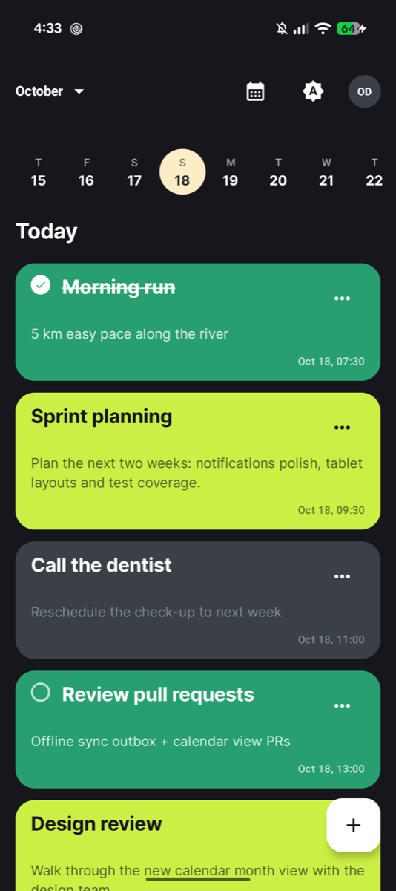
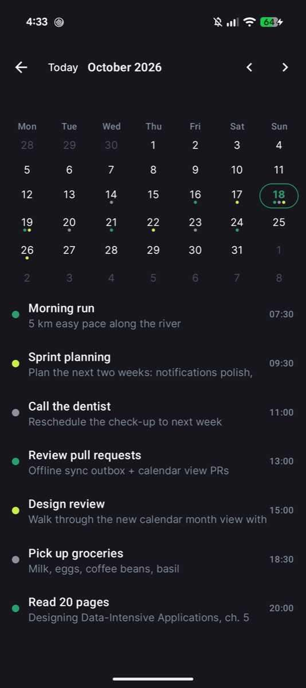
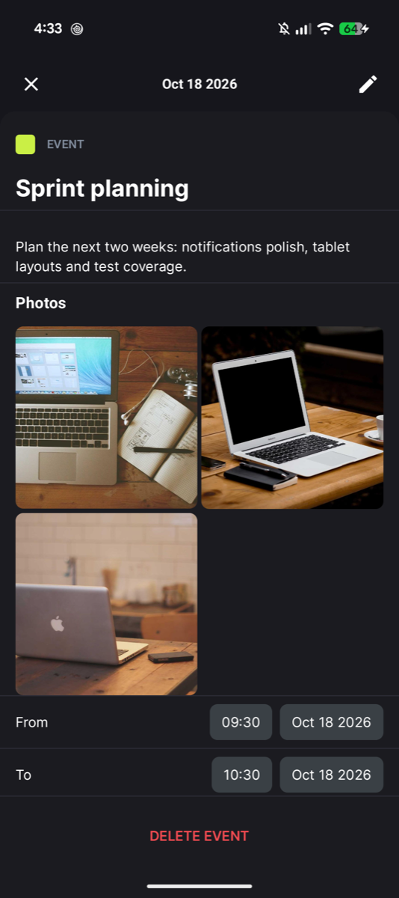
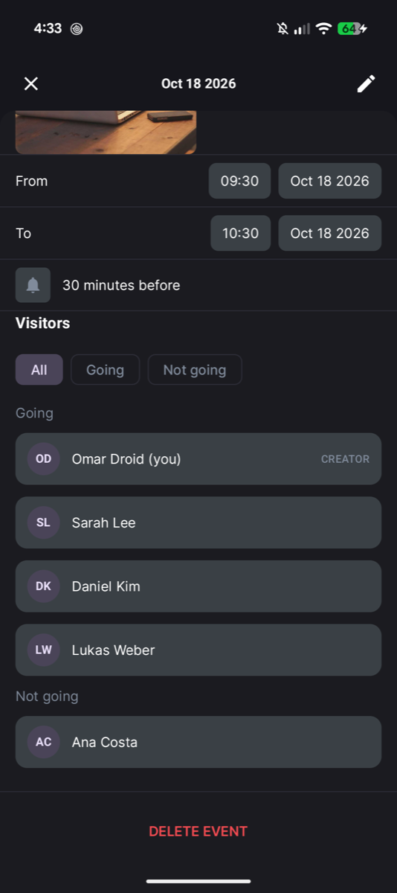
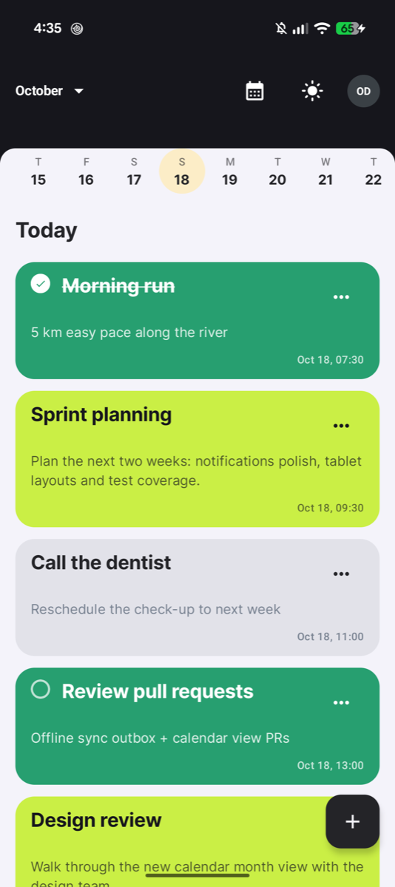
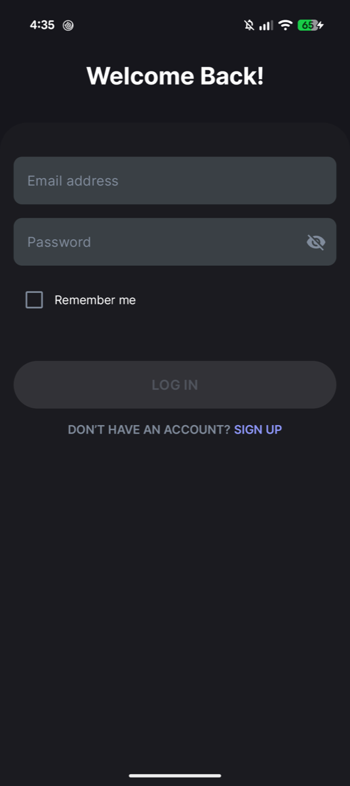

# 🗓️ Tasky – Personal Task & Agenda Manager


[](https://github.com/OmarDroid/tasky-app/actions/workflows/android.yml)

Tasky is a modern, **offline-first** agenda and task management app built with Kotlin and Jetpack Compose.
It helps users organize their daily schedule with **events**, **tasks**, and **reminders**, with a clean and responsive UI for both phones and tablets.

This repository is an extended edition of the app I built during the **DROP TABLE Mentoring Program**. On top of the full program scope, it adds a calendar month view for jumping to any date and an encrypted "remember me" login.

## Screenshots

<p align="center">
  
  
  
  
</p>
<p align="center">
  
  
</p>

---

## Features

**Authentication**
- Register and log in with live input validation
- Session persistence with automatic access-token refresh
- **Remember me** – credentials are encrypted with the Android Keystore (AES) and used to prefill the login form, never to log in silently

**Agenda**
- Agenda view that combines events, tasks, and reminders on one timeline
- Horizontal day strip with a "now" indicator
- **Calendar month view** with colored dots per item type, a day list, month arrows and a **Today** shortcut
- **Jump to any date**: pick a day in the calendar and the agenda moves to it

**Detail screens**
- One shared detail screen for tasks, reminders, and events (view and edit modes)
- Events with attendees (email lookup, going / not going) and photos
- Full-screen photo viewer
- Reminder offsets (10 min, 30 min, 1 h, 6 h, 1 day before)

**Offline-first sync**
- Every write lands in Room first, so the UI never waits on the network
- An **outbox** of pending operations is pushed when the device is online and queued when it isn't. Repeated edits to the same item are merged into one pending operation
- WorkManager sync runs as soon as the device comes back online, plus a periodic full sync every 30 minutes
- Two-phase photo upload (pre-signed S3 URLs, then a confirm step), with local photo caching

**Notifications**
- Exact reminder alarms via `AlarmManager`, rescheduled after device reboot
- Event-invite notifications that open the matching item through a deep link
- Respects `POST_NOTIFICATIONS` and exact-alarm permission gating

**User experience**
- Dark / light theme toggle, saved with DataStore
- Adaptive layouts for phone portrait, phone landscape, and tablet
- Material 3 design with edge-to-edge display and a splash screen

---

## Tech Stack

| Area | Libraries |
|---|---|
| UI | Jetpack Compose, Material 3, Material 3 Adaptive, Coil |
| Architecture | Clean Architecture, MVI (State / Action / Event), Koin |
| Async | Kotlin Coroutines & Flow |
| Local data | Room, DataStore Preferences, Android Keystore |
| Networking | Ktor Client (Auth, Content Negotiation, Logging), kotlinx.serialization |
| Background | WorkManager (Koin worker factory), AlarmManager |
| Navigation | Type-safe Navigation Compose |
| Date & time | kotlinx-datetime, `kotlin.time.Instant` |
| Testing | JUnit4, Turbine, AssertK, Robolectric, MockK, Compose UI Test |

---

## Architecture

The app is a single module organized by layer and by feature:

```
com.omaroid.tasky
├── app/                 # Application, MainActivity, Koin modules, navigation, startup
├── core/
│   ├── domain/          # Models, repository interfaces, use cases, validation, Result types
│   ├── data/            # Room, Ktor, outbox sync, notifications, crypto, DataStore
│   └── presentation/    # Design system, theme, adaptive layout helpers, UI utilities
└── feature/
    ├── auth/            # Login & register
    ├── agenda/          # Agenda timeline
    ├── calendar/        # Month view
    ├── detail/          # Task / reminder / event details + photo viewer
    └── edittext/        # Full-screen title & description editor
```

**Data flow (MVI)**
1. The UI sends **Actions** to the ViewModel.
2. The ViewModel exposes one immutable **State** through `StateFlow`. Room flows are combined straight into the state with `combine` + `stateIn`, so the screen updates whenever the database changes.
3. One-off **Events** (navigation, snackbars) go through a `Channel` and are collected with `ObserveAsEvents`.
4. Errors are typed (`DataError`) and mapped to localized `UiText` only at the UI layer.

**Offline-first write path**

```
ViewModel ─► Repository ─► Room (source of truth) ─► UI updates immediately
                       └─► Outbox.sync { push() }
                              ├─ online & success → done
                              └─ offline / failure → PendingOperation queued
                                                     └─► SyncWorker retries later
```

---

## Testing

- **160+ tests** across JVM unit tests and instrumented tests
- ViewModel tests with Turbine, fake repositories backed by `MutableStateFlow`, and an injected `FakeClock`
- Room DAO tests on an in-memory database, including boundary tests for date-range queries
- Repository, outbox, sync, and notification tests
- Compose UI tests for the login, register, and edit-text screens

```bash
./gradlew testDebugUnitTest          # JVM unit tests
./gradlew connectedDebugAndroidTest  # instrumented tests (device or emulator required)
```

---

## Getting Started

**Requirements:** Android Studio (latest stable) and JDK 17+. Gradle downloads the JDK 21 it runs on automatically.

1. Clone the repository:
   ```bash
   git clone https://github.com/OmarDroid/tasky-app.git
   ```
2. Add your Tasky API key to `local.properties` (this file is not committed):
   ```properties
   apiKey=YOUR_API_KEY
   ```
3. Open the project in Android Studio and run the `app` configuration.

> The app talks to the Tasky backend provided by PL Coding for the mentoring program, so an API key is needed to use the online features.

---

## 12-Week Mentoring Program

Tasky was built as part of the [**DROP TABLE 12-Week Mentoring Program**](https://pl-coding.com/drop-table-mentoring) by PL Coding,
where participants learn to architect, implement, and publish a complete app following real-world development practices.

---

## Author

**GitHub:** [github.com/OmarDroid](https://github.com/OmarDroid)

---

> 📘 *Built with ❤️ during the DROP TABLE Mentoring Program by PL Coding, and extended afterwards.*
